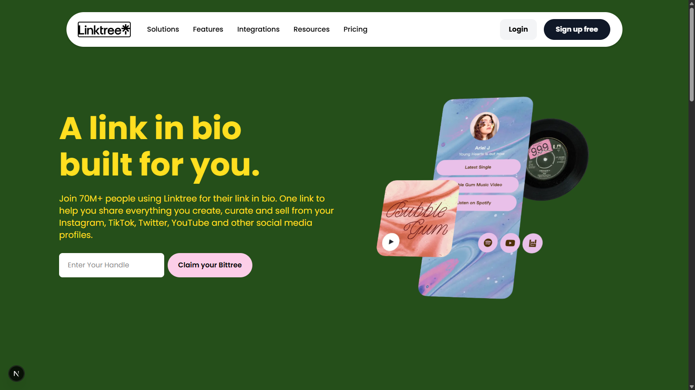
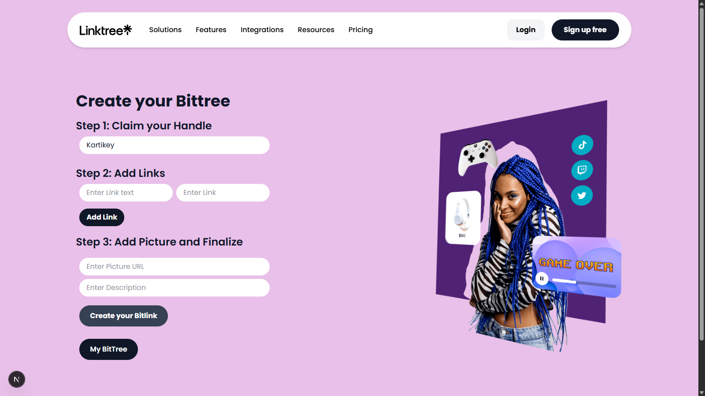
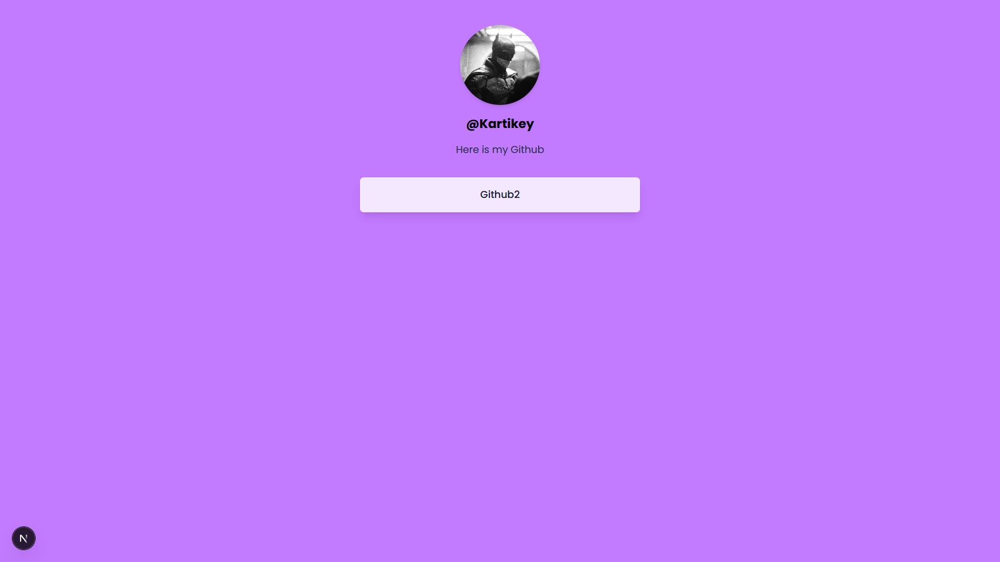
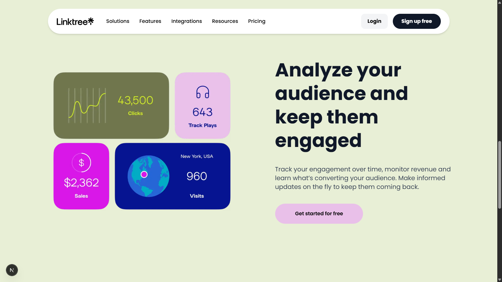

# BitTree

A minimalist link-in-bio web application built with Next.js and Tailwind CSS.

## Screenshots

| | |
| :---: | :---: |
|  |  |
|  |  |

## Tech Stack

- Next.js (App Router)
- Tailwind CSS
- MongoDB

## Features

- Custom handle (`/yourname`)
- Unlimited links & profile bio
- Responsive design across all devices

## Setup

```bash
git clone [https://github.com/your-username/bittree.git](https://github.com/your-username/bittree.git)
cd bittree
npm install
npm run dev